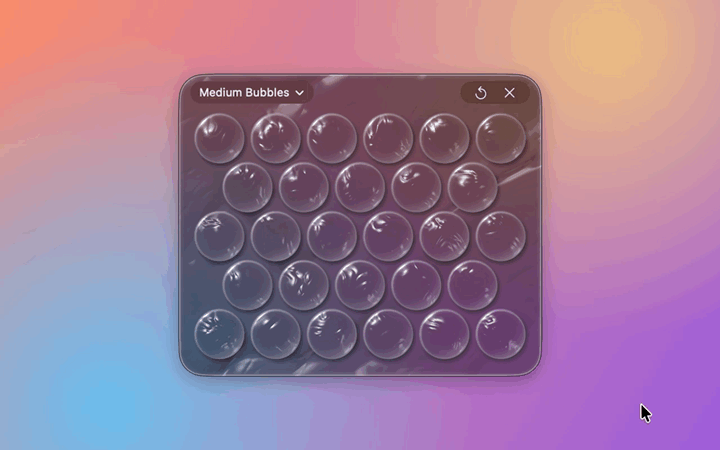

# Bubble Wrap

Deadline in an hour? Inbox at 99+? Third "quick sync" of the day?

Pop.

Bubble Wrap is a sheet of bubble wrap that lives on your Mac. Squeeze a bubble, hear the crack, feel your shoulders come down a little. Work stress, that email you're avoiding, plain old anxiety: give it a bubble and pop it. Run out of bubbles? It refills. Stress doesn't stand a chance.

[Watch it with sound](assets/bubble-wrap.mp4)

## Download

| Release date | Download |
| --- | --- |
| 11 Nov 2026 | [BubbleWrap-1.0.0.dmg](https://github.com/ntsh08/Bubble-Wrap/releases/download/v1.0.0/BubbleWrap-1.0.0.dmg) |

Open the DMG and drag Bubble Wrap into Applications.

Needs macOS 14 or later. Works on Apple Silicon and Intel Macs. Signed and notarized by Apple, so it opens like any other app.

## Privacy

Bubble Wrap counts how many Macs open it each day and which sheet people pick, using [TelemetryDeck](https://telemetrydeck.com). It sends an anonymous random ID, the app version and your macOS version. No names, no accounts, nothing about what's on your screen.

## More

Found a bug or have an idea? [Open an issue](https://github.com/ntsh08/Bubble-Wrap/issues).
