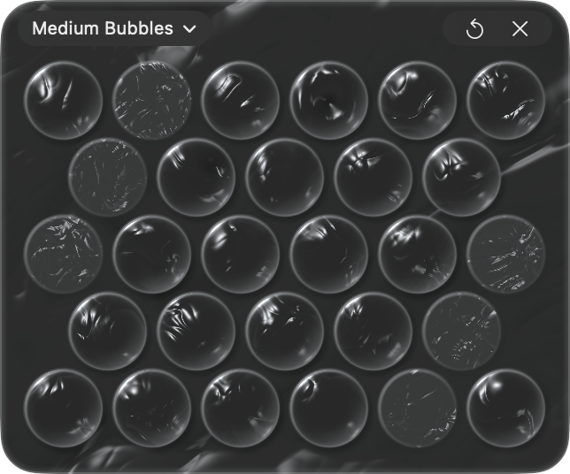

# Bubble Wrap

A sheet of bubble wrap that floats on your Mac's desktop. Press a bubble and it pops, with a real crack and a little tap on the trackpad. That's it.

The sheet is clear plastic: you see your desktop through it, softly blurred. It stays on top of your windows so it's always there when you need a break, and it never takes over your keyboard.

## Download

| Release date | Download |
| --- | --- |
| 11 Nov 2026 | [BubbleWrap-1.0.0.dmg](https://github.com/ntsh08/Bubble-Wrap/releases/download/v1.0.0/BubbleWrap-1.0.0.dmg) |

Open the DMG and drag Bubble Wrap into Applications.

Needs macOS 14 or later. Works on Apple Silicon and Intel Macs. Signed and notarized by Apple, so it opens like any other app.

## Using it

- **Pop:** press a bubble. On a Force Touch trackpad, press harder and the bubble squishes before it gives. Drag across the sheet to pop a whole row.
- **Pick a sheet:** click the sheet name at the top left.
  - **Small Bubbles:** lots of tiny ones that snap.
  - **Medium Bubbles:** classic bubble wrap.
  - **Large Bubbles:** four big ones with a deep bang.
  - **Air Columns:** long tubes, like the wrap wine bottles come in.
- **New sheet:** click ↺, or pop every bubble and it refills on its own.
- **Move it:** drag the top strip.
- **Hide it:** click ×. Click Bubble Wrap in the Dock to bring it back.
- **Quit:** ⌘Q, or right-click it in the Dock.

## Privacy

Bubble Wrap counts how many Macs open it each day, using [TelemetryDeck](https://telemetrydeck.com). It sends an anonymous random ID, the app version and your macOS version. No names, no accounts, nothing about what's on your screen.

## More

Found a bug or have an idea? [Open an issue](https://github.com/ntsh08/Bubble-Wrap/issues).
